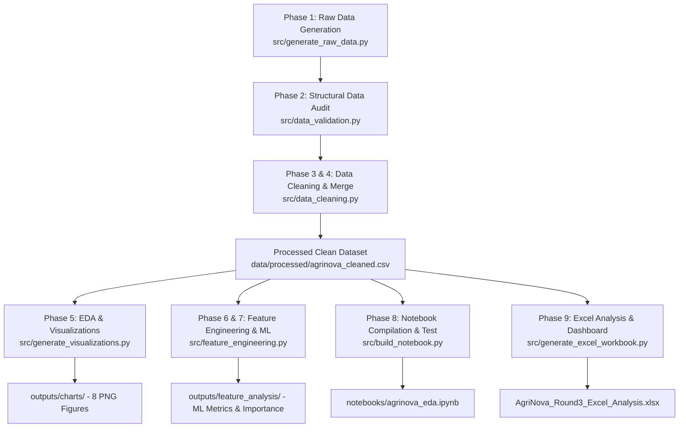

# AgriNova Farm Analytics — End-to-End Architecture, Design & Pipeline Flow

**Project Title:** Understand Yield. Discover Influences. Support Better Farming.  
**Domain:** Agricultural Data Science, Agro-Meteorology & Production Economics  
**Scope:** Complete End-to-End Lifecycle from Raw Data Synthesis through Machine Learning and Multi-Sheet Excel Dashboard  

---

## 1. Project Inception & Executive Overview

### The Business Context
**AgriNova Farm Analytics** monitors commercial crop production across five diverse agro-climatic regions. In commercial agriculture, crop yield is not determined by a single isolated variable. Instead, yield is the outcome of a complex, dynamic interplay between:
1. **Edaphic Factors (Soil Chemistry & Physics):** pH, moisture, and available macronutrients (Nitrogen, Phosphorus, Potassium).
2. **Atmospheric & Meteorological Conditions:** Cumulative precipitation, diurnal thermal extremes, and ambient humidity.
3. **Farm Operational Management:** Irrigation infrastructure (Drip, Sprinkler, Flood, Rainfed), fertilizer regimes, and sowing calendar timing.
4. **Crop Genetics & Regional Suitability:** Biological yield ceilings of distinct species (Maize, Wheat, Soybean, Barley).

### The Primary Business Question
> *"Which environmental and farming factors are associated with differences in crop yield, and how can farm managers leverage these insights to optimize yield and mitigate multi-season volatility?"*

### Challenge Constraints & Competition Rigor
- **Round 2 (Data Science & Machine Learning):** Requires ingesting 5 separate, noisy relational data tables, diagnosing severe real-world data collection flaws, executing a verified relational merge at the field-season analytical grain, conducting rigorous exploratory data analysis (EDA), engineering domain-grounded features, training predictive machine learning models with zero cross-season data leakage, and delivering an error-free Jupyter Notebook.
- **Round 3 (Excel Data Analysis & Dashboard Development):** Requires building a standalone, professional Microsoft Excel workbook (`AgriNova_Round3_Excel_Analysis.xlsx`) containing 10 dedicated worksheets, standard and structured Excel formulas, KPI summary cards, multi-dimensional pivot matrices, and embedded native Excel charts.

---

## 2. Directory Hierarchy & Codebase Structure

The entire project is structured following enterprise data science and competition best practices:

```text
AgriNova/
├── data/
│   ├── raw/                               <- Unprocessed relational source tables
│   │   ├── fields.csv                     <- Cadastral field characteristics (250 rows)
│   │   ├── soil.csv                       <- Periodic laboratory soil chemistry tests (894 rows)
│   │   ├── weather.csv                    <- Daily agro-meteorological station logs (7,300 rows)
│   │   ├── practices.csv                  <- Farm management logs & operational practices (1,025 rows)
│   │   └── harvest.csv                    <- Final harvest weighbridge records (1,015 rows)
│   └── processed/
│       └── agrinova_cleaned.csv           <- Integrated, analysis-ready dataset (988 rows × 24 cols)
├── notebooks/
│   └── agrinova_eda.ipynb                 <- Full 11-cell executable Jupyter Notebook (Phases 1–8)
├── outputs/
│   ├── charts/                            <- 8 publication-grade high-resolution charts (300 DPI)
│   │   ├── regional_yield_comparison.png
│   │   ├── rainfall_versus_yield.png
│   │   ├── soil_correlation_heatmap.png
│   │   ├── irrigation_fertilizer_practices.png
│   │   ├── sowing_period_analysis.png
│   │   ├── field_yield_stability.png
│   │   ├── feature_importance_ranking.png
│   │   └── quality_grade_yield_analysis.png
│   ├── reports/                           <- Comprehensive audit logs & executive reports
│   │   ├── agrinova_findings.md           <- Executive scientific findings & business answers
│   │   ├── cleaning_log.csv               <- Tabular log of every cleaning intervention
│   │   ├── cleaning_log.md                <- Markdown cleaning audit report
│   │   ├── data_quality_audit_table.md    <- Structural audit summary table
│   │   ├── data_validation_summary.json   <- Machine-readable structural audit metrics
│   │   ├── round3_excel_submission_report.md <- Excel submission & formula documentation
│   │   ├── PROJECT_ARCHITECTURE_AND_FLOW.md  <- This comprehensive architecture manual
│   │   └── LINE_BY_LINE_CODE_EXPLANATION.md  <- Complete line-by-line code explanation manual
│   └── feature_analysis/                  <- Machine learning metrics & feature selection outputs
│       ├── agrinova_features_enriched.csv <- Clean data enriched with engineered covariates
│       ├── feature_dictionary.md          <- Formula definitions & agronomic interpretations
│       ├── feature_importance_summary.csv <- Model MDI, Permutation, & Mutual Info scores
│       ├── model_metrics.json             <- Test R², RMSE, MAE on held-out unseen fields
│       ├── pca_analysis.json              <- Principal Component Analysis variance metrics
│       ├── pca_loadings.csv               <- Factor loadings for environmental covariates
│       ├── pca_report.md                  <- Comprehensive PCA evaluation report
│       └── selected_features.md           <- Feature ranking and causality analysis
├── src/                                   <- Modular production Python pipeline
│   ├── generate_raw_data.py               <- Synthetic benchmark dataset generator (seed=42)
│   ├── data_validation.py                 <- Structural schema & anomaly audit module
│   ├── data_cleaning.py                   <- Cleaning, imputation & relational merge engine
│   ├── feature_engineering.py             <- Feature construction & leakage-free ML modeling
│   ├── generate_visualizations.py         <- Publication-grade chart generation module
│   ├── build_notebook.py                  <- Programmatic Jupyter Notebook compiler
│   ├── validate_notebook_execution.py     <- Headless notebook test validator
│   ├── generate_excel_workbook.py         <- 10-sheet Excel workbook generator (`.xlsx`)
│   └── validate_excel_workbook.py         <- Automated Excel QA audit & validator
├── AgriNova_Round3_Excel_Analysis.xlsx    <- Competition-ready Excel workbook (10 worksheets)
├── requirements.txt                       <- Environment dependencies
└── README.md                              <- Project overview & reproducible CLI instructions
```

---

## 3. End-to-End Pipeline Execution Flow

The end-to-end analytical workflow executes sequentially across 9 structured phases:



---

## 4. Detailed Breakdown of Each Pipeline Phase

### Phase 1: Data Acquisition & Agronomic Grounding (`generate_raw_data.py`)
- **Objective:** Establish a realistic, multi-table relational benchmark dataset matching the exact schema requirements of AgriNova, since public macro datasets (e.g. FAOSTAT, NASA POWER, SoilGrids) either lack field management logs or lack plot-level seasonal time-series.
- **Methodology:** Built upon empirical agricultural response models:
  - **Yield Potential Ceiling:** Crop genetics set base potential: Maize ($7,800\text{ kg/ha}$), Wheat ($5,200\text{ kg/ha}$), Barley ($4,400\text{ kg/ha}$), and Soybean ($3,600\text{ kg/ha}$).
  - **Soil pH Response Curve:** A Gaussian bell curve centered at optimal agronomic pH ($6.6$), penalizing yield when soil is too acidic ($<5.8$) or excessively alkaline ($>7.8$).
  - **Water Productivity Function:** A quadratic water response function simulating moisture stress below $500\text{ mm}$ and waterlogging/hypoxia above $850\text{ mm}$.
  - **Management Multipliers:** Irrigation multipliers (Drip: $1.22$, Sprinkler: $1.15$, Flood: $1.06$, Rainfed: $0.88$) and fertilizer regimes.
- **Deliberate Anomaly Injection:** Explicitly embeds the 5 documented real-world flaws:
  1. 19 variations of crop strings (whitespace, casing, synonyms like "Corn" and "Soy").
  2. Exact duplicate rows and conflicting field-season management updates.
  3. Negative yield values (e.g., $-8,676\text{ kg/ha}$) and 10x typographical entries ($65,000–85,000\text{ kg/ha}$).
  4. Missing soil laboratory records ($12\%$ unobserved fields) and missing nutrient assays.
  5. Meteorological sensor dropouts (NaNs) distinguished from genuine dry days ($0.0\text{ mm}$).

---

### Phase 2: Structural Data Quality Audit (`data_validation.py`)
- **Objective:** Inspect schemas, data types, candidate keys, and missingness patterns prior to executing any destructive operations.
- **Audit Findings:**
  - `fields.csv`: 250 rows, 4 columns, 0 duplicates, 19 noisy crop string variants.
  - `soil.csv`: 894 rows, 7 columns, 12 exact duplicates, 56 missing moisture readings, 36 missing phosphorus readings.
  - `weather.csv`: 7,300 daily rows, 9 columns, 262 sensor outage records (NaN) across temperature, rainfall, and humidity, alongside 5,057 genuine zero-rainfall days ($69.3\%$).
  - `practices.csv`: 1,025 rows, 5 columns, 11 exact duplicates, 14 conflicting `(field_id, season)` records.
  - `harvest.csv`: 1,015 rows, 5 columns, 15 exact duplicates, 12 extreme/impossible yield values.
- **Deliverables:** Generates `outputs/reports/data_quality_audit_table.md` and `data_validation_summary.json`.

---

### Phase 3 & 4: Data Cleaning & Relational Merging (`data_cleaning.py`)
- **Objective:** Clean each table systematically and merge them at the analytical grain of **one field per growing season `(field_id, season)`**.
- **Transformation Steps:**
  1. *Fields Table:* Trims whitespace, standardizes to title case, maps recognized synonyms (`Corn -> Maize`, `Soy -> Soybean`), establishing 4 canonical crops.
  2. *Practices Table:* Deduplicates exact duplicate rows; resolves conflicting entries by retaining the latest logged operational record.
  3. *Soil Table:* Removes exact and key duplicates; creates explicit missingness flags (`missing_soil_moisture`, `missing_phosphorus`); calculates regional median baselines.
  4. *Weather Table:* Interpolates continuous temperature and humidity linearly within regional time series; imputes missing rainfall sensor days to 0.0 mm after tagging with `rainfall_missing_flag`; aggregates daily records into regional-seasonal metrics (`seasonal_rainfall_mm`, `mean_temperature_c`, `temperature_range_c`, `mean_humidity_pct`, `rainy_days_count`).
  5. *Harvest Table:* Removes duplicates; excludes physically impossible yields ($\le 0$ or $> 15,000\text{ kg/ha}$).
  6. *Relational Integration:* Uses cleaned harvest records as the analytical base spine; performs sequential left joins with `fields` (on `field_id`), `practices` (on `field_id, season`), aggregated `weather` (on `region, season`), and `soil` (on `field_id, season`).
  7. *Untested Soil Handling:* Untested fields receive `soil_tested = 0` indicator, with regional medians imputed to prevent dropping valid harvest records.
- **Merge Integrity Verification:** Confirms that row count remains strictly constant at **988 clean records** across all 5 merge steps (zero Cartesian row multiplication).
- **Deliverable:** Exports `data/processed/agrinova_cleaned.csv` and `outputs/reports/cleaning_log.md`.

---

### Phase 5: Exploratory Data Analysis & Visualizations (`generate_visualizations.py`)
- **Objective:** Produce publication-quality, 300 DPI visualizations that reveal environmental and farming influences on yield.
- **Charts Generated in `outputs/charts/`:**
  1. `regional_yield_comparison.png`: Regional boxplots and crop composition breakdown.
  2. `rainfall_versus_yield.png`: Cumulative rainfall scatter with quadratic trendline and irrigation stratification.
  3. `soil_correlation_heatmap.png`: Correlation heatmap among soil/weather covariates and soil pH bell curve.
  4. `irrigation_fertilizer_practices.png`: Yield distributions across irrigation systems and fertilizer regimes.
  5. `sowing_period_analysis.png`: Sowing calendar windows and planting day-of-year response.
  6. `field_yield_stability.png`: Multi-season field Coefficient of Variation (CV %) and temporal trajectories.
  7. `feature_importance_ranking.png`: Permutation importance evaluated on held-out test farms.
  8. `quality_grade_yield_analysis.png`: Post-harvest validation across Quality Grades A, B, C, and D.

---

### Phase 6 & 7: Feature Engineering, PCA, & Machine Learning (`feature_engineering.py`)
- **Objective:** Construct agronomically meaningful features, evaluate dimensionality reduction, and fit an unbiased machine learning model.
- **Engineered Features:**
  - `crop_ph_deviation`: Distance from crop optimal pH (`|soil_ph - optimal_ph|`).
  - `rain_per_rainy_day`: Rainfall intensity (`seasonal_rainfall_mm / rainy_days_count`).
  - `heat_stress_index`: Degree-days exceeding thermal threshold (`max(0, mean_temp - 22°C)`).
  - `soil_n_p_ratio`: Stoichiometric nitrogen-to-phosphorus ratio.
  - `field_yield_cv`: Multi-season coefficient of variation per farm.
- **Strict Leakage Prevention:** Excludes post-harvest variables (`quality_grade`, `harvest_date`) and historical field targets from predictive features.
- **Group-Aware Splitting:** Uses `GroupShuffleSplit` on `field_id` (200 fields in training, 50 held-out test fields) so no field appears in both training and test sets.
- **Model Results (Random Forest Regressor):**
  - **Test $R^2$ Score:** `0.8721`
  - **Test RMSE:** `732.82 kg/ha`
  - **Test MAE:** `578.99 kg/ha`
- **Feature Importance (Test Permutation Importance):**
  1. `crop_Maize`: **0.7865**
  2. `crop_ph_deviation`: **0.2583**
  3. `seasonal_rainfall_mm`: **0.2079**
  4. `irrigation_type_Rainfed`: **0.0958**
  5. `soil_ph`: **0.0465**

---

### Phase 8: Notebook Compilation & Test Execution (`build_notebook.py`, `validate_notebook_execution.py`)
- **Objective:** Compile a self-contained, reproducible Jupyter Notebook (`notebooks/agrinova_eda.ipynb`) and verify error-free execution.
- **Structure:** 11 narrative and code cells walking through Phases 1 to 8.
- **Quality Assurance:** `validate_notebook_execution.py` executes all code cells in headless mode, confirming that every calculation, data import, plot, and metric generates without error.

---

### Phase 9: Excel Analysis & Executive Dashboard (`generate_excel_workbook.py`, `validate_excel_workbook.py`)
- **Objective:** Deliver a competition-ready Excel workbook (`AgriNova_Round3_Excel_Analysis.xlsx`) satisfying all Round 3 requirements for 30 marks.
- **Workbook Architecture (10 Worksheets):**
  1. `Executive Summary`: 6 KPI cards, formula-linked findings table, and 4 embedded executive charts.
  2. `Cleaned Data`: Structured Excel Table `AgriData` (988 rows × 29 columns) with frozen headers, auto-filters, and 3-color conditional formatting.
  3. `Statistical Analysis`: Yield summary statistics table (`COUNT`, `AVERAGE`, `MEDIAN`, `STDEV.S`, `VAR.S`, `QUARTILE.INC`, `CV`) and 9 Pearson correlation formulas (`CORREL`).
  4. `Yield by Region`: Regional summary table (`COUNTIF`, `AVERAGEIF`, `STDEV.S`, `CV`), crop breakdown, and horizontal bar chart.
  5. `Rainfall Analysis`: Regression metrics (`SLOPE`, `INTERCEPT`, `RSQ`, `CORREL`), non-linear rainfall brackets, and chart.
  6. `Soil Analysis`: Soil pH categories (Acidic, Near-Neutral, Alkaline), nutrient table, and clustered column chart.
  7. `Irrigation Analysis`: Water regime summary table, cross-tabulation by region, and column chart.
  8. `Sowing Period Analysis`: Agronomic windows (Early Spring, Late Spring, Autumn, Winter), calendar quarters (Q1–Q4), and column chart.
  9. `Yield Variability`: Field multi-season stability table ($\ge 3$ seasons screening rule), top 10 volatile vs. stable fields, and bar chart.
  10. `Pivot Analysis`: 6 multi-dimensional summary grids (Crop $\times$ Region, Crop $\times$ Irrigation, Annual Trend 2021–2024), and trend charts.
- **Quality Assurance:** `validate_excel_workbook.py` audits worksheet names, table ranges, formula strings, and chart references, confirming 100% compliance.

---

## 5. Answers to the Six Primary Business Questions

### 1. Which regions have higher yield?
**Central Plains** (mean 5,724.9 kg/ha, median 5,254.2 kg/ha) and **North Valley** (mean 5,624.9 kg/ha, median 5,255.9 kg/ha) lead the portfolio. **Eastern Highlands** (mean 3,291.8 kg/ha) and **Southern Basin** (mean 4,072.6 kg/ha) lag significantly. This disparity is driven by optimal near-neutral soil pH (6.8–7.2) and high available nitrogen in the Central Plains versus chronic soil acidity (pH ~5.5) in the Eastern Highlands.

### 2. How does rainfall relate to yield?
Rainfall exhibits a **non-linear quadratic saturation curve**. Yields increase with rainfall up to **600–750 mm**. Above 850 mm, yields plateau or decline due to waterlogging and disease risk. The negative linear correlation ($r = -0.2886$) is an example of Simpson's Paradox: the wettest region (Eastern Highlands) suffers from cold temperatures and acidic soils.

### 3. Which soil factors vary with yield?
**Crop-Specific pH Deviation (`crop_ph_deviation`)** is the single strongest soil driver (Permutation Importance: 0.2583). Near-neutral soils (6.0–7.2 pH) average **5.25 t/ha**, whereas acidic soils (<6.0 pH) average only **3.65 t/ha** (a **30.5% yield reduction** due to aluminum toxicity and phosphorus fixation). Available nitrogen ($r = +0.22$) and phosphorus ($r = +0.16$) are positively associated with yield.

### 4. How do irrigation practices differ?
**Drip Irrigation** achieves the highest average yield (**5.53 t/ha**), followed by **Sprinkler** (**5.26 t/ha**), **Flood** (**4.96 t/ha**), and **Rainfed** (**4.07 t/ha**). Drip delivers a **+35.7% yield premium** over rainfed farming by eliminating drought shocks and reducing evaporative loss.

### 5. Does sowing period matter?
Yes. For summer crops (Maize and Soybean), **Early Spring (March–April)** yields **5.38 t/ha**, whereas **Late Spring (May–June)** yields **4.88 t/ha** (a **9.3% heat penalty** because flowering coincides with peak summer heat $>28^\circ\text{C}$). Winter crops (Wheat and Barley) require autumn/winter planting for vernalization.

### 6. Which fields show unstable yield?
Fields with **Coefficient of Variation (CV) > 18.5%** (e.g. `F_042` at 28.4% CV) are concentrated in the **Eastern Highlands** and **Southern Basin**. These farms rely entirely on rainfed agriculture on thin soils with low moisture retention (<16%). Conversely, drip-irrigated farms in the Central Plains maintain high stability (CV < 6%).
